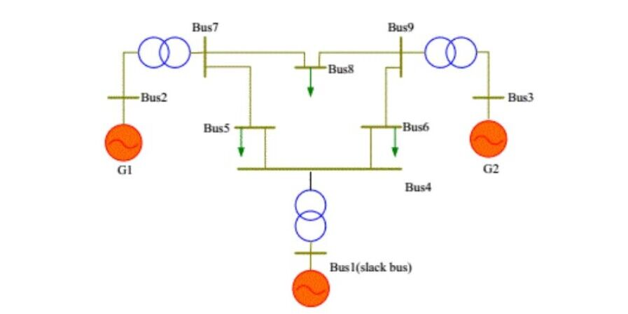
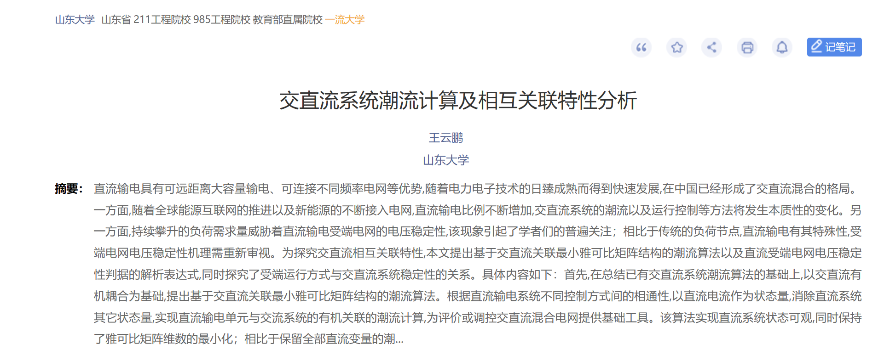

# MATLAB | Unified Iteration Method for Load Flow of AC-DC Interconnected System with 9 Nodes

MATLAB|Unified Iteration Method for Load Flow of AC-DC Interconnected System
\n        \n  
\n        \n  

## Images

<!-- PAYMENT_BLOCK -->

## Get this dataset

- Payment link (Stripe): [Buy now](https://buy.stripe.com/3cs8yP7sY87d0vu9AB)
- Payment QR code: 

<!-- /PAYMENT_BLOCK -->
